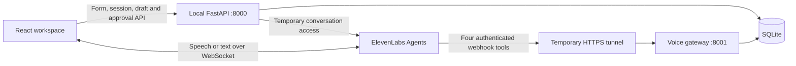

# Hearth — Landlord repair workspace

Hearth turns a spoken maintenance request into a checked, editable repair draft. The landlord reviews the saved details and clicks **Approve work order** to save one work order. Contractor messages remain drafts; requested dates are not confirmed bookings.

This is a local, single-landlord demonstration using fictional records, labelled **Demo data**. It includes a structured repair form, real ElevenLabs voice/text conversations, record checks, revision history, cancellation, and repeat-safe approval. Milestone 5 verification is complete. Milestone 6 prepares the submission documents; Milestone 7 features remain deferred.

## Submission documents

- [Project overview for the Google Doc](docs/submission-overview.md)
- [4 minute 30 second demonstration script](docs/demo-script.md)
- [Actual Milestone 5 verification](docs/milestone-5-verification.md), with live and simulated checks distinguished
- [Build log and recorded coding prompts](docs/build-log.md)

The overview is source material for a Google Doc. A recorded video and published submission are separate deliverables.

## Architecture

The stack is React, TypeScript, Vite, Tailwind CSS, Python/FastAPI, SQLite, and `@elevenlabs/react` with `ConversationProvider`. There is no LangChain dependency. The npm lockfile and pinned Python requirements record the installed dependencies.



The frontend runs on `127.0.0.1:5173` and proxies `/api` to port `8000`. Only the separate voice gateway is exposed through the tunnel. Both Python services use the same SQLite database and repair functions.

| Agent tool | Purpose |
| --- | --- |
| `lookup_property` | Resolve a property and unit; ask for clarification if missing, ambiguous, or unknown. |
| `check_open_jobs` | Find possible duplicates for the unit, trade, and issue. |
| `lookup_maintenance_context` | Return approved contractors, relevant history, and policy. |
| `prepare_repair_draft` | Save a new draft or revise the same draft using its exact ID and revision. |

A random local app-session ID identifies the current workflow. The backend issues temporary ElevenLabs access and a conversation binding; webhook authentication checks its secret, exact conversation ID, expiry, and revocation. The model cannot choose another app session. The native `end_call` tool disconnects the call but has no approval authority.

Approval exists only on the local review-card API, outside the public gateway. It rechecks details, eligibility, duplicates, and urgency, rejects stale/cancelled drafts, and saves the reviewed revision in a transaction. Repeated approvals return the same order. While a conversation is active or its final saved state is unresolved, approval is blocked.

## Requirements and first setup

The verified development environment is macOS, Python **3.14.6**, Node **25.9.0**, npm **11.12.1**, and Git. Frontend tests execute TypeScript directly with Node; use the verified Node version when reproducing the results. Other operating systems/runtime versions have not been verified. Voice additionally needs a microphone, internet, `cloudflared`, and an ElevenLabs account with **Agents access and available credits/minutes**.

Open Terminal in the project root—the folder containing `backend`, `frontend`, and this README. Run these once, or after dependencies change:

```sh
python3 -m venv backend/.venv
backend/.venv/bin/python -m pip install -r backend/requirements.txt
npm --prefix frontend ci
```

The structured form works without ElevenLabs credentials. To prepare voice configuration without overwriting existing values:

```sh
backend/.venv/bin/python scripts/elevenlabs_setup.py init
backend/.venv/bin/python scripts/elevenlabs_setup.py check
```

`init` creates/updates the root `.env` and generates a random webhook secret. `check` prints only configured/missing status. [.env.example](.env.example) contains blank placeholders, not credentials.

## Local environment variables

The API and gateway read the root `.env`; exported environment variables take precedence. Restart those two project services after changing configuration. Do not put secrets in frontend code or `VITE_` variables.

| Variable | Required for | Meaning |
| --- | --- | --- |
| `ELEVENLABS_API_KEY` | Voice/text agent | Server-side key with the Agents permissions needed by the setup helper and temporary-access endpoint. |
| `ELEVENLABS_AGENT_ID` | Voice/text agent | A dedicated Hearth agent in your ElevenLabs account. |
| `HEARTH_WEBHOOK_SECRET` | Voice/text agent | Random secret of at least 32 characters; provisioning stores it as an ElevenLabs workspace secret. |
| `HEARTH_VOICE_PUBLIC_URL` | Voice/text agent | Current HTTPS tunnel origin pointing to gateway port `8001`, with no path/query. |
| `HEARTH_VOICE_MAX_SECONDS` | Optional | Maximum call/binding duration; default `600`, clamped to 60–600 seconds. |
| `REPAIR_DB_PATH` | Optional | Shared database path for both Python services. Default `backend/data/repairs.sqlite3`; use an absolute path when overriding. |

Enter credentials locally at the hidden prompt, never in chat:

```sh
backend/.venv/bin/python scripts/elevenlabs_setup.py set ELEVENLABS_API_KEY
backend/.venv/bin/python scripts/elevenlabs_setup.py set ELEVENLABS_AGENT_ID
```

Create a dedicated blank agent and check account access/credits before provisioning. Follow the [ElevenLabs setup guide](docs/elevenlabs-tools-setup.md) for the exact four tools, header sources, permissions, and agent instructions.

## Start the services

Keep each service in its own terminal. Start each command from the project root.

**Terminal 1 — local API**

```sh
backend/.venv/bin/python -m uvicorn backend.app.main:app --host 127.0.0.1 --port 8000 --no-access-log
```

**Terminal 2 — frontend**

```sh
npm --prefix frontend run dev
```

Open **http://127.0.0.1:5173/**. These two services are enough for the repair form. Local API documentation is at **http://127.0.0.1:8000/docs**.

**Terminal 3 — voice webhook gateway**

```sh
backend/.venv/bin/python -m uvicorn backend.app.voice_gateway:app --host 127.0.0.1 --port 8001 --no-access-log
```

**Terminal 4 — temporary HTTPS tunnel**

```sh
cloudflared tunnel --url http://127.0.0.1:8001 --no-autoupdate
```

Use an installed `cloudflared`; installation and temporary-hostname behavior are described in [Cloudflare's Quick Tunnel documentation](https://developers.cloudflare.com/tunnel/get-started/quick-tunnels/). Quick Tunnels are for development and have no uptime guarantee. Tunnel **8001 only**; the frontend, approval API, sessions, and database remain local.

Save the new HTTPS origin printed by the tunnel using a fifth terminal:

```sh
backend/.venv/bin/python scripts/elevenlabs_setup.py set HEARTH_VOICE_PUBLIC_URL
```

Restart Terminal 1 and Terminal 3 with Control+C and their same commands. Then configure the dedicated agent and its tool URLs:

```sh
backend/.venv/bin/python scripts/elevenlabs_provision.py check-agent
backend/.venv/bin/python scripts/elevenlabs_provision.py provision --dedicated-agent-id YOUR_AGENT_ID
```

Replace `YOUR_AGENT_ID` with the same ID saved locally. Provisioning updates that dedicated agent's prompt/tools and reuses its saved setup IDs; it preserves the chosen voice and model. Never use it against an unrelated production agent. Start conversations **from Hearth**, because the ElevenLabs dashboard preview has no Hearth app-session binding.

If a port is already occupied, first open Hearth and reuse the working server. To identify the listener on macOS:

```sh
lsof -nP -iTCP:5173 -iTCP:8000 -iTCP:8001 -sTCP:LISTEN
```

Check its command and working directory before restarting anything. Stop only this project's service in its terminal, not an unrelated process. Do not run a second copy to resolve a port conflict.

## Check and renew the voice tunnel

A running tunnel process is not proof its public URL still works. Run this from the project root before recording; it sends no credentials, starts no conversation, and writes no repair records:

```sh
backend/.venv/bin/python - <<'PY'
from backend.app.drafts import DraftConflict
from backend.app.voice import VoiceSettings, check_public_gateway

settings = VoiceSettings.from_env()
if not settings.available:
    raise SystemExit('Voice configuration is incomplete. Run the local setup check.')
try:
    check_public_gateway(settings)
except DraftConflict as error:
    raise SystemExit('FAIL: ' + error.content['message'])
print('PASS: the HTTPS lookup route returns the expected authenticated-gateway response (401 without credentials).')
PY
```

The expected response is **401 `unauthorized_tool`** to an unauthenticated POST at `/voice/tools/lookup_property`. Public `/api/work-orders` and `/docs` should return **404**. Hearth performs this connectivity preflight automatically before issuing temporary conversation access. It checks reachability from this computer; only a real agent tool call verifies the full ElevenLabs path.

If preflight fails, check that port `8001` is running and inspect the tunnel terminal. M5 encountered `Tunnel not found` and a vanished DNS hostname while the process was still alive. Restart only Hearth's tunnel, save its new origin, restart the two Python services, and rerun the same provision command so all four tool URLs match. Recheck before starting voice. Keep the existing `.env`, setup state, and SQLite database; credentials do not need to be replaced simply because the hostname changed.

## Fictional data and the review flow

[seed.json](backend/data/seed.json) contains three properties: **Maple Court Unit 4**, **Cedar House Unit 4**, and **Willow Place Unit 2**. Ahmed handles plumbing at Maple/Cedar; Lea handles electrical work at all three; Ben handles general repairs at all three. Cedar has a seeded open bathroom-tap repair. There are two completed sample jobs, one maintenance-history record, and a short policy. No real contact information is included.

Startup seeds once. Existing drafts, revisions, approvals, and jobs survive restarts. A fresh checkout creates its own database from the seed; it does not include this workspace's private saved records.

| Example | Expected behavior |
| --- | --- |
| Maple Court kitchen tap | On a fresh seed, match Unit 4 and Ahmed. In the verified local workspace, its existing approved order makes it a possible duplicate. |
| Cedar House bathroom tap | Flag the seeded open repair. |
| Unit 4 without a property | Ask for Cedar House or Maple Court; do not guess. |
| Unknown property | Show that the property was not found. |
| Willow Place plumbing | Require human review; no approved plumber is invented. |

For a new request, use the form or Start conversation. The agent checks records, asks one question at a time, and saves a draft. Correct a detail while staying in the same call. Say “All good” or “Goodbye” to end; review the saved revision on the card, then click **Approve work order**. Reload and expand its saved details. **Cancel draft** is terminal for that draft; **New request** begins another workflow after approval/cancellation.

The current local workspace has four work orders and an unapproved skirting-board test draft. Use the fresh-repair instructions in the [demo script](docs/demo-script.md), which preserve those records. Rehearsal approvals persist and can make that repair a duplicate next time. Do not erase a database or an existing draft to repeat a demonstration.

## Verification

From the project root:

```sh
backend/.venv/bin/python -m pytest -q
npm --prefix frontend test
npm --prefix frontend run build
```

The root pytest command includes backend and setup-helper tests. The frontend build runs TypeScript checking and produces `frontend/dist/`. It does not deploy the app. For a local production-build preview, stop only this project's Vite development server first and run `npm --prefix frontend run preview -- --port 5173 --strictPort`; keep the API running. Use port 5173 because the local voice-origin guard expects it.

M5 evidence: **143 backend/setup tests plus 11 subtests passed**, **33 frontend tests passed**, and the production build passed. Real speech verified draft creation and correction in one conversation, automatic hang-up, and visible saved results. Real approval retries/reload retained one exact reviewed order. Microphone denial, network loss, clarification, duplicates, cancellation, stale approval, urgency, and layouts were checked. See the [verification report](docs/milestone-5-verification.md) for each check's method and limits.

## Current limitations

- Local single-landlord demo, not a hosted multi-user product. The random app-session ID is a local capability, not account authentication. Do not expose the main API publicly.
- Fictional records only. Customer demand, time savings, financial benefit, and willingness to pay have not been measured.
- Duplicate and urgency checks are deterministic rules; they are not comprehensive diagnosis or semantic matching. Urgent concerns require human review.
- The form uses structured fields; natural conversation requires ElevenLabs. Voice needs network access, credits, microphone permission, and a working temporary tunnel. Recognition, model behavior, and latency can vary.
- Saved drafts/orders persist in SQLite; unsaved edits are temporary. A new conversation resumes saved draft details, not the previous spoken transcript. Browser transcript display is limited to recent turns; this app does not archive full conversations in SQLite.
- No contractor messages are sent, no availability is checked, and no booking is confirmed. Approved orders are immutable; the agent cannot approve, cancel, or send them.
- Mobile layouts were checked at 320px and 390px in browser emulation; physical-phone testing is **NOT TESTED**. Automated external-provider behavior is simulated where the report says so.
- The production build passes with a nonblocking bundle-size warning (about 886 kB minified / 244 kB gzip). Production hosting, broader authentication, and Milestone 7 features are deferred.

## Repository contents

Source and documentation are prepared in a local Git repository. `.gitignore` excludes `.env`, local databases and journals, ElevenLabs setup state, logs, dependencies, caches, coverage, and build output. The safe `.env.example`, fictional `seed.json`, dependency lockfile, and tests are included. A GitHub destination is selected only after local preparation; no remote or published repository is implied by these files.

| Path | Contents |
| --- | --- |
| `frontend/src/` | Workspace, review card, typed API calls, SDK conversation controller. |
| `backend/app/` | FastAPI routes, validated contracts, shared checks, SQLite approval transactions. |
| `backend/tests/`, `frontend/tests/`, `scripts/test_elevenlabs_setup.py` | Business rules, state, setup, failure and approval tests. |
| `scripts/elevenlabs_*.py` | Local secret setup, exact tool rendering, dedicated-agent provisioning. |
| `docs/elevenlabs-agent-prompt.md` | Agent instructions and human-approval boundary. |
| `docs/elevenlabs-tools-setup.md` | Detailed account/tool configuration reference. |
| `docs/submission-overview.md`, `docs/demo-script.md` | Submission text and timed recording plan. |
